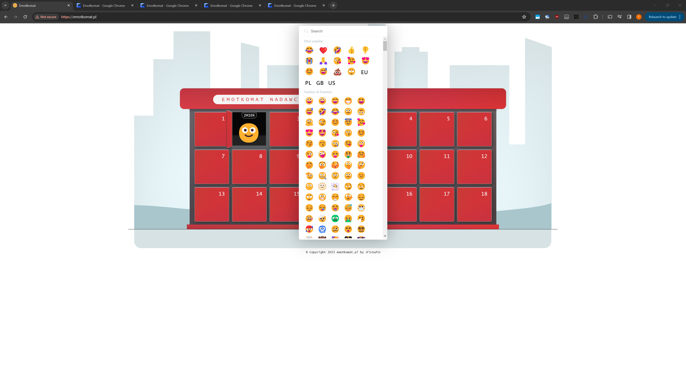
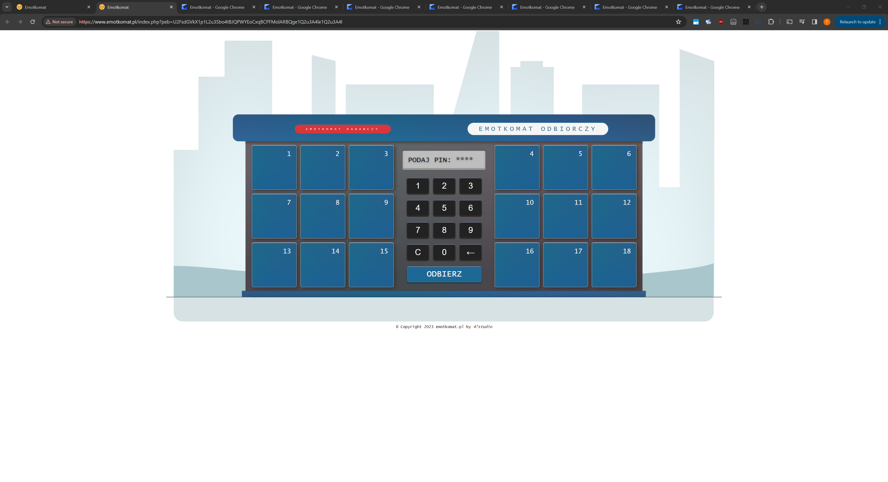

# Emotkomat


*2021: original git history*

An emoji vending machine. Pick a locker, set a PIN, and send an emoji — share the link and PIN so a friend can open the matching locker and collect it.

> Emotkomat was live at `emotkomat.pl` in 2021. The domain and hosting have since been let go; this repo preserves the project.

## How it works

1. Pick a numbered locker ("skrytka")
2. Choose an emoji from the picker
3. Set a 4-digit PIN and press "NADAJ"
4. Copy the message with the link and PIN and send it to a friend
5. The friend opens the link, enters the PIN and presses "ODBIERZ" — the matching locker opens and reveals the emoji

## Demo

| Sending (nadawczy) | Receiving (odbiorczy) |
|---|---|
| [](screenshots/desktop/sending.png) | [](screenshots/desktop/receiving.png) |

| [](https://youtu.be/1KLDA0Ikamk) |
|---|
| [](https://youtu.be/1KLDA0Ikamk) |

## Structure

```
index.php          Final, deployed app page
index.js           App logic
style.css          Styles
emojis.php         Emoji data
software.php       MIT license text for the CodePen emoji picker code
favicon_io/        The app's own icon
screenshots/       Images for the Demo section
legacy/            Original vanilla JS/HTML prototype (Oct–Dec 2021), kept for history
    emotkomat.php  Earlier, pre-jQuery first attempt
```

## Usage

```bash
php -S localhost:8000
```

Open `http://localhost:8000/index.php`. Requires PHP 7.0 or newer and an internet connection (jQuery and CryptoJS load from CDNs). No database or data files are needed.

The generated link always starts with `https://www.emotkomat.pl/`. To open it locally, replace that part with `http://localhost:8000/`. The HTTPS redirect in `.htaccess` only works on Apache; PHP's built-in server ignores it.

## Tech

PHP, JavaScript with jQuery 3.5.1, CSS (grid and SVG backgrounds). The message is encrypted in the browser with CryptoJS (Rabbit cipher) and carried in the link, so there is no database and no server-side state. PHP only switches between sender and receiver mode and includes the emoji picker. jQuery and CryptoJS are loaded from CDNs.

## Credits

- Emoji picker UI adapted from [a CodePen by Tu Truong](https://codepen.io/lufutu/pen/gWygjW), MIT licensed. License text included in `software.php`.
- Favicon generated from [Twemoji](https://github.com/twitter/twemoji) (`1f60a.svg`), © Twitter, Inc. and contributors, CC-BY 4.0.

## License

MIT License — see [LICENSE](LICENSE).
